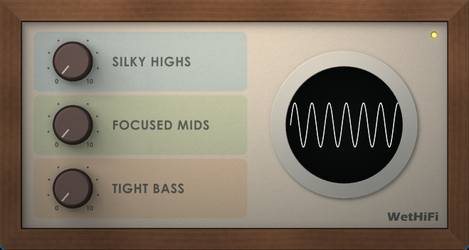

# WetHiFi

Ever thought your mix missed those silky highs, focused mids or tight bass from
real hi-fi equipment? WetHiFi helps you add just what you are missing with simple
controls and a useful scope to help judge the effects of your mixing decisions!
While maybe looking simple on the outside, this stereo audio processor packs a lot
of time-tested tricks behind its classic exterior. The blue circuit does not just
raise the higher frequencies but also brings additional harmonics into the sound
for a more exciting top end. The green circuit is a useful cut/boost configured to
work exactly on presence as experienced by the human ear, while the red circuit
cleans up muddy bass using a decades-old EQ trick, all with the twist of a single
knob! To top it off, the mini LED helps monitor proper output signal levels.



## The knobs

**Tight Bass** boosts the deep low end and cuts a little just above it, so the
bass gets bigger without getting boomy.

**Focused Mids** boosts the middle and cuts a little higher up, so it comes
forward without getting harsh.

**Silky Highs** is a shelf that opens up the top end, a small dip below it
against harshness, and an exciter that adds some shine.

Each knob runs from 0 to 10. At 0 the sound passes through untouched.

### Mouse

- **Wheel**: one detent per notch, or one fine step with Shift held
- **Shift-drag**: fine adjust, four steps inside every detent
- **Right-click the panel**: UI Zoom, from 50% to 125%

## Download & Installation

### Windows

1. **Download** the latest release from [wetvst.com](https://wetvst.com/) or [GitHub Releases](https://github.com/yonie/WetHiFi/releases)
2. **Extract** the ZIP file
3. **Copy** `WetHiFi.vst3` to your VST3 folder:
   - User: `C:\Users\[Username]\Documents\VST3\`
   - System: `C:\Program Files\Common Files\VST3\`
4. **Restart your DAW** and rescan plugins

### Linux

1. **Download** the latest release from [wetvst.com](https://wetvst.com/) or [GitHub Releases](https://github.com/yonie/WetHiFi/releases)
2. **Extract** the ZIP file
3. **Copy** `WetHiFi.vst3` to your VST3 folder:
   - User: `~/.vst3/`
   - System: `/usr/lib/vst3/`
4. **Restart your DAW** and rescan plugins

### macOS

1. **Download** the latest release from [wetvst.com](https://wetvst.com/) or [GitHub Releases](https://github.com/yonie/WetHiFi/releases)
2. **Extract** the ZIP file
3. **Copy** `WetHiFi.vst3` to your VST3 folder:
   ```
   ~/Library/Audio/Plug-Ins/VST3/
   ```
4. **Copy** `WetHiFi.component` to `~/Library/Audio/Plug-Ins/Components/` for Logic and GarageBand
5. **Restart your DAW** and rescan plugins

Note that by default, the Library folder may not be shown in the Finder. See the macOS documentation on how to make it visible.

The plug-in is signed and notarised by Apple, so macOS opens it without a warning.

#### If macOS still blocks it

If macOS says the plug-in "cannot be opened because the developer cannot be verified", remove the quarantine flag in Terminal and restart your DAW:

```bash
xattr -cr ~/Library/Audio/Plug-Ins/VST3/WetHiFi.vst3
xattr -cr ~/Library/Audio/Plug-Ins/Components/WetHiFi.component
```

## Building from Source

### Step 1: Clone VST3 SDK

If the `vst3sdk` folder is not present, clone it:

```batch
git clone --recursive https://github.com/steinbergmedia/vst3sdk.git
```

### Step 2: Build

#### Windows

```batch
build.bat
```

Output: `WetHiFi\build\VST3\Release\WetHiFi.vst3`

#### Linux / macOS

```bash
chmod +x build.sh
./build.sh
```

Output: `WetHiFi/build/VST3/Release/WetHiFi.vst3`

### Step 3: Install

#### Windows

```batch
install.bat
```

#### Linux / macOS

```bash
chmod +x install.sh
./install.sh
```

---

## Author

**Ronald Klarenbeek**
- Website: [https://wetvst.com](https://wetvst.com)
- Email: contact@wetvst.com
- GitHub: [https://github.com/yonie](https://github.com/yonie)

## License

MIT License - Copyright © 2026 Ronald Klarenbeek (Yonie)

This project is licensed under the MIT License - see the [LICENSE](LICENSE) file for details.
